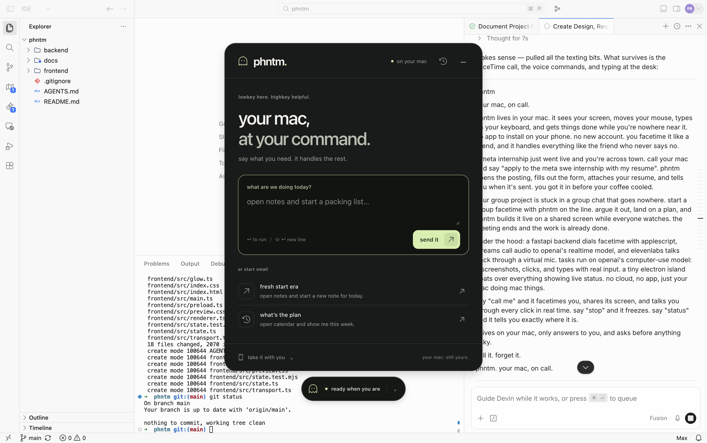
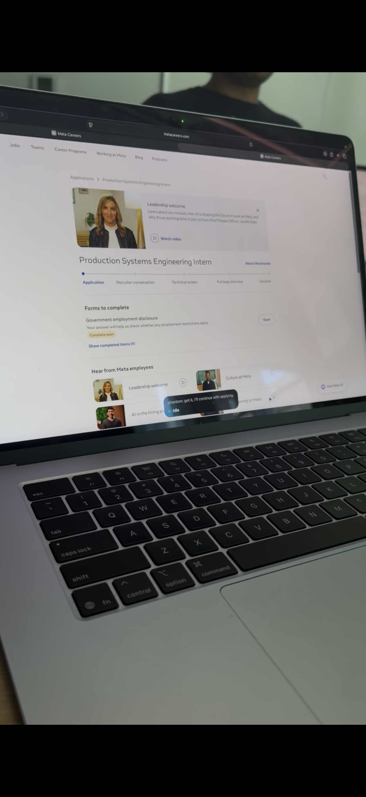
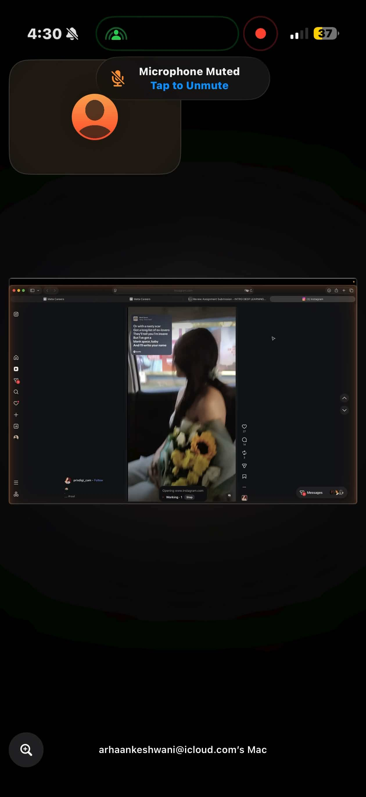

<p align="center">
  
</p>

# phntm

### your mac, on call.

phntm lives in your mac. it sees your screen, moves your mouse, types on your keyboard, and gets things done while you're nowhere near it. no app to install on your phone. no new account. you facetime it like a friend, and it handles everything like the friend who never says no.

## what it does

- **call it.** phntm facetimes you, shares its screen, and talks you through every click in real time.
- **watch it work.** a tiny island floats over everything showing live status — calling, listening, thinking, working — readable from your phone through the shared screen.
- **talk to it.** say "phantom, …" and it does the thing. say "stop" and it freezes.

a meta internship just went live and you're across town. call your mac and say "apply to the meta swe internship with my resume". phntm opens the posting, fills out the form, attaches your resume, and tells you when it's sent. you got it in before your coffee cooled.

## screenshots



<p align="center">
  
  
  
</p>

<p align="center"><sub>the command panel · applying to a meta internship · submitting an assignment · driving the mac over facetime</sub></p>

## run it

backend (needs `backend/.env`):

```
cd backend && uv run uvicorn main:app --reload --timeout-graceful-shutdown 2
```

frontend:

```
cd frontend && pnpm install && pnpm start
```

type a task in the island, hit enter. the agent screenshots your mac, asks the model what to do, and clicks and types for you.

## setup

`backend/.env`:

```
OPENAI_API_KEY=sk-...
SELF_NUMBER=+1...           # the phone the mac should call
ELEVENLABS_API_KEY=sk_...   # optional — phantom's voice on calls
ELEVENLABS_VOICE_ID=...     # optional
```

**permissions** — the terminal that runs the backend needs accessibility, screen recording, microphone, and full disk access. macOS asks the first time; grant them all and restart the backend.

**call audio** — install two virtual audio devices:

```
brew install blackhole-2ch blackhole-16ch
```

then in facetime's menu bar → video: output → **blackhole 2ch** (your voice to the agent), microphone → **blackhole 16ch** (phantom's voice to you). if facetime has no output option, set the system output to a multi-output device (audio midi setup → + → multi-output device, tick blackhole 2ch and your speakers).

## how it works

a fastapi backend dials facetime with applescript, streams call audio to openai's realtime model, and elevenlabs talks back through blackhole 16ch. tasks run on openai's computer-use model: it screenshots, clicks, and types with real input. the electron island floats over everything, and the screen edges glow with the current phase — white listening, red working, amber calling, green done.

`cmd+shift+space` focuses the island to type at the desk. enter runs, esc stops.

## docs

[requirements](docs/requirements.md) · [design](docs/design.md) · [tasks](docs/tasks.md)

---

text it\* (\*once the imessage trigger is back). call it. forget it.

**phntm. your mac, on call.**
