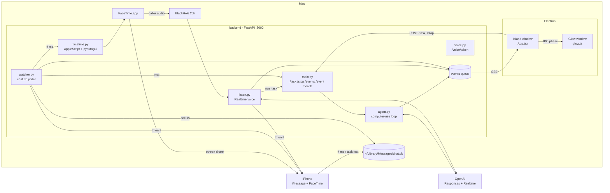
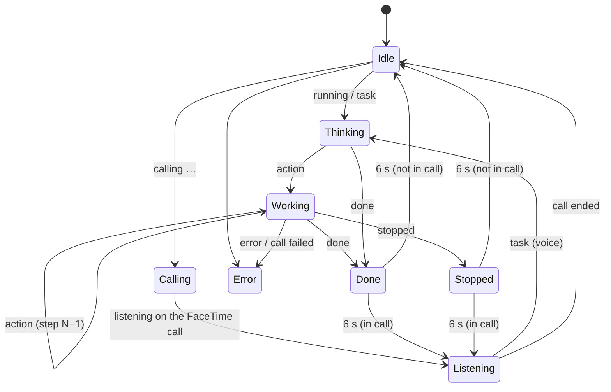
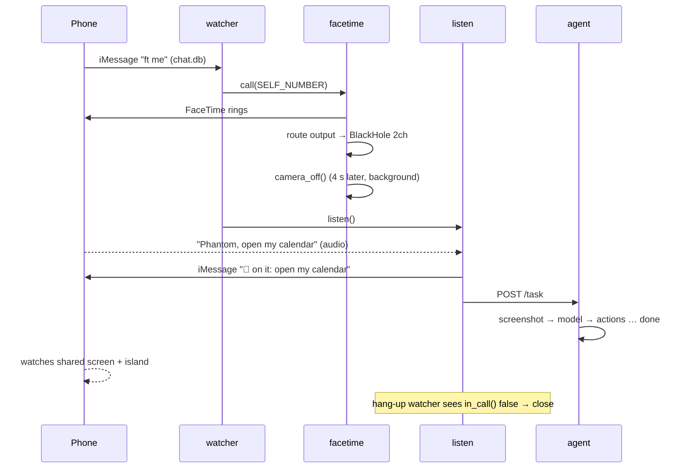

# phntm — Design

How phntm is built today, and where it's headed. Requirements are in [requirements.md](requirements.md); work items in [tasks.md](tasks.md).

## 1. Overview

Two processes on the same Mac, talking over `http://127.0.0.1:8000`:

- **Backend** (`backend/`, Python 3.12, FastAPI, `uv`) — runs the computer-use agent, watches iMessage, drives FaceTime, listens to the call. Publishes everything as events.
- **Frontend** (`frontend/`, Electron 45 + React 19, `pnpm`, Electron Forge + webpack) — a status island and an edge-glow overlay. Subscribes to events; sends typed tasks.

## 2. Backend components

| File | Responsibility |
|---|---|
| `main.py` | FastAPI app. Owns the global `events` queue, the `stop` flag and the single `worker` thread. Starts `watcher.watch` on boot. |
| `agent.py` | Computer-use loop (R1). OpenAI Responses API with the `computer` tool + `open_app` / `open_url` functions, chained via `previous_response_id`. Executes actions with `pyautogui`; key names mapped to macOS (`cmd` → `command`, `alt` → `option`). Model from `OPENAI_MODEL`. Max 60 turns. |
| `watcher.py` | iMessage trigger (R4). Read-only SQLite on `chat.db`, polling every 1 s for `is_from_me = 1` rows in the self-chat newer than the last seen `ROWID`. Decodes `attributedBody` typedstream when `text` is null. Starts the call flow or posts a task. |
| `facetime.py` | FaceTime automation (R5). AppleScript via `osascript` for dialing, finding the unnamed "Call" button, detecting connection ("Take Live Photo" button), routing output to BlackHole 2ch from the Video menu, and `in_call()` detection. Camera-off uses real mouse clicks because Control Center ignores Accessibility clicks. |
| `listen.py` | Voice on the call (R6). Streams 24 kHz mono int16 from BlackHole 2ch into an OpenAI Realtime session (semantic VAD, `gpt-4o-transcribe`, text output). Handles `run_task` / `stop_task` tool calls by POSTing to its own API. A hang-up watcher polls `in_call()` every 5 s and closes the session when the call drops. |
| `voice.py` | Shared Realtime config (Phantom persona, tools) and `GET /voice/token`, which mints short-lived client secrets so the API key never reaches Electron. Currently unused by the frontend. |
| `imessage.py` | `send(number, text)` via AppleScript to Messages. |

### HTTP API

| Method | Path | Body | Purpose |
|---|---|---|---|
| POST | `/task` | `{text}` | Stop any running task, start a new one. |
| POST | `/stop` | – | Set the stop flag. |
| GET | `/events` | – | SSE stream of events; `: ping` every 1 s when idle. |
| POST | `/event` | `{type, text}` | Inject an event (debug / external sources). |
| GET | `/health` | – | `{ok: true}`. |
| GET | `/voice/token` | – | Short-lived Realtime client secret. |

### Event protocol

Every event is `{type, text}`. The island's reducer keys off these strings, so they are effectively a contract:

| `type` | `text` examples | Island phase |
|---|---|---|
| `status` | `running` | Thinking |
| `status` | `done` | Done |
| `status` | `stopped`, `stopped: hit turn limit` | Stopped |
| `status` | `error: …`, `call failed: …`, `iMessage watch off: …` | Error |
| `status` | `calling +1…` | Calling (inCall) |
| `status` | `listening on the FaceTime call` | Listening (inCall) |
| `status` | `call ended` | Idle (not inCall) |
| `status` | `watching iMessage: …` | Idle |
| `action` | `click {"x":…}`, `open_app Notes` | Working · step N |
| `message` | `task: …`, `task from iMessage: …` | Thinking (step = task) |
| `message` | model's final sentence | step text |
| `heard` | transcript | *ignored today* (R2.6) |
| `facetime` | – | Calling (*never emitted*) |

Matching on free-text prefixes is fragile; see task T-refactor-events.

## 3. Frontend components

- **`main.ts`** — creates two frameless, transparent, always-on-top windows visible on all Spaces including fullscreen:
  - *Glow* — full primary-display bounds, `focusable: false`, `setIgnoreMouseEvents(true)`, level `screen-saver` 0.
  - *Island* — bottom-centre, 14 px above the work area, level `screen-saver` 1. Resizes to whatever size the renderer reports (animated), growing upward.
  - Registers Cmd+Shift+Space to focus the island. Hides the Dock icon.
  - IPC: `resize`, `blur`, `phase` (forwarded island → glow).
- **`preload.ts`** — exposes `window.bar` (`resize`, `blur`, `phase`, `onPhase`).
- **`App.tsx`** — island UI. One `useReducer` phase machine driven by SSE events plus a 1 s tick that returns Done/Stopped to rest after 6 s. `describe()` turns raw actions into readable steps with macOS key glyphs. A `ResizeObserver` reports content size to main.
- **`glow.ts` / `glow.css`** — sets `body[data-phase]`; CSS draws the coloured edge light.

### Phase state machine

## 4. Key flows

### Remote flow (`ft me`)

### Desk flow
Cmd+Shift+Space → type → Enter → `POST /task` → same agent loop → events → island/glow.

## 5. Concurrency model

- One FastAPI process. Long work runs in daemon threads: watcher (forever), one agent worker, per-call `start_call` / `listen` / pump / hang-up threads.
- `events` is a single `queue.Queue`. **Each SSE client pops from the same queue**, so with two clients connected each sees only some events. Fine for one island; a fan-out broadcaster is needed for more (e.g. a phone/web view).
- `stop` is one `threading.Event`, checked between model output items — an action batch already executing finishes first.
- A new `/task` sets `stop`, joins the old worker for up to 10 s, then starts the new one.

## 6. External dependencies

- **OpenAI Responses API** with the `computer` tool (model via `OPENAI_MODEL`).
- **OpenAI Realtime** (`gpt-realtime-2.1`, `gpt-4o-transcribe`, semantic VAD).
- **BlackHole 2ch** (call → backend) and **BlackHole 16ch** (agent voice → call, reserved for R6.6).
- macOS: AppleScript / System Events, `open`, Control Center, Messages `chat.db`.

## 7. Permissions

The terminal that runs the backend needs: Accessibility (clicks, AppleScript UI), Screen Recording (screenshots), Microphone (BlackHole input), Full Disk Access (chat.db). Messages in iCloud must be on.

## 8. Security notes

- API key stays in `backend/.env`; Electron only ever gets short-lived Realtime secrets.
- chat.db is opened read-only and only the self-chat is read.
- Gaps: no auth on the local API and `allow_origins=["*"]` — a web page in any browser on the Mac could `POST /task`. The agent acknowledges all model safety checks automatically. Both are tracked in tasks.md.

## 9. Known gaps vs README / requirements

- Screen sharing on pickup (R5.4) is documented but not triggered.
- Live caption card (R2.6) is documented but `heard` events are ignored.
- `/voice/token` and the `facetime` event type are unused leftovers from the earlier in-Electron voice design.
- No automated tests.
- `pnpm install` fails on the lockfile policy on a clean Mac.

## 10. Design decisions

| Decision | Why |
|---|---|
| OpenAI Realtime instead of local STT/TTS | One service does VAD + transcription + intent; much less glue. |
| Voice runs in the backend, not Electron | Backend owns the BlackHole input and the call lifecycle; key stays server-side. |
| Electron island instead of a web dashboard | Must be visible on the shared screen, above fullscreen apps, and readable from a phone. |
| SSE instead of WebSockets | Events are one-way; commands are plain POSTs. |
| Self-chat only trigger | No risk of texting/calling anyone else; the self-chat is also the reply channel. |
| `open_app` / `open_url` tools | Spotlight and address-bar typing were slow and flaky for the model. |
| Real mouse clicks for Control Center | Accessibility clicks don't register on its toggles. |
